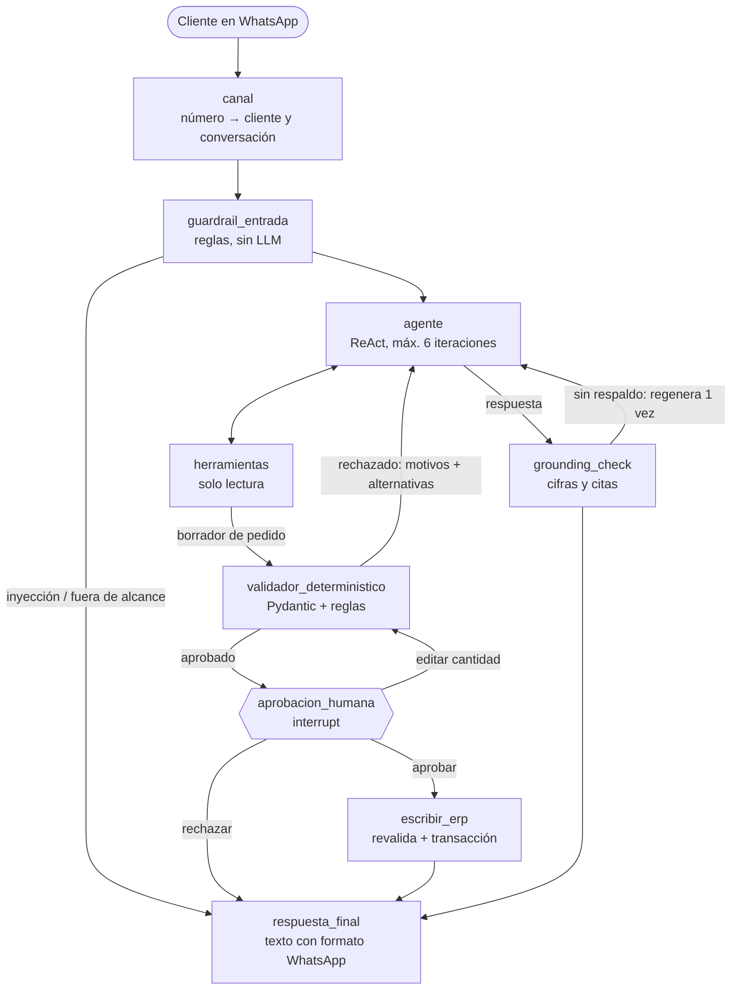

# Agente de ventas por WhatsApp para una florícola (RAG + aprobación humana)

Prototipo de un agente con **LangChain + LangGraph** que atiende por chat a importadores y floristerías de una florícola exportadora: cotiza rosas y flores de verano, revisa disponibilidad por finca, toma pedidos y responde dudas de envíos, temporadas, reclamos y cuidado de la flor.

El chat de la demo **imita WhatsApp** y el agente ya responde con el formato del canal. La conexión con la API real de WhatsApp es el siguiente paso (ver [Camino a WhatsApp](#camino-a-whatsapp)).

**El agente nunca escribe en el ERP por su cuenta.** Todo pedido pasa por un validador determinista (código, no LLM) y por la aprobación de una persona.

   

> *Rosaflor Andina* es una florícola **ficticia**. Clientes, números de WhatsApp, identificaciones, precios y stock son datos inventados para la demo.

## El problema

En una florícola, los pedidos llegan por WhatsApp a cualquier hora y desde varios husos horarios (Miami, Ámsterdam, Moscú). Un vendedor tarda horas en responder una cotización porque tiene que revisar precios, stock en cada finca y crédito del cliente. Un agente de IA puede responder en segundos, pero el negocio tiene tres miedos:

| Preocupación | Cómo lo resuelve el prototipo |
|---|---|
| **Que invente precios o datos** | Solo responde con datos del ERP (herramientas) o de las políticas (RAG). Un chequeo de *grounding* revisa que cada cifra y cada cita salgan de esas fuentes; si no, regenera la respuesta o escala a un asesor. |
| **Pedidos erróneos** | Una regla detecta que es un pedido y **obliga** a pasarlo por el validador: variedad, bonches completos de 25 tallos, stock por finca, precio del ERP, descuento máximo y crédito. Después, aprobación humana obligatoria. El agente solo tiene acceso de lectura. |
| **Costo** | ~**$0,00039 por consulta** con Azure gpt-4o-mini (≈ $0,78 al mes para 2.000 chats). |

> **Principio de diseño:** lo que se puede decidir con una regla, no lo decide el LLM. El modelo redacta y elige herramientas; el código valida, calcula y decide los pasos críticos.

## Arquitectura



| Componente | Archivo | Rol |
|---|---|---|
| Grafo del agente | [`src/graph.py`](src/graph.py) | Nodos, aristas, reintentos, respaldo de proveedor, respuesta final |
| Canal WhatsApp | [`src/whatsapp.py`](src/whatsapp.py) | Formato de WhatsApp, límite de 4.096 caracteres, número → conversación |
| Validador | [`src/validators.py`](src/validators.py) | Reglas de negocio deterministas y alternativas ya calculadas |
| Guardrails | [`src/guardrails.py`](src/guardrails.py) | Anti-inyección, fuera de alcance y detección de intención |
| Herramientas | [`src/tools.py`](src/tools.py) | 6 tools de solo lectura sobre el ERP y las políticas |
| RAG | [`src/rag.py`](src/rag.py) | Chroma + embeddings locales multilingües |
| Grounding | [`src/grounding.py`](src/grounding.py) | Verifica cifras y citas de la respuesta |
| ERP simulado | [`src/erp_client.py`](src/erp_client.py) | SQLite: lectura en modo `ro`, escritura separada |
| Costos | [`src/costs.py`](src/costs.py) | Callback de tokens y costo estimado |
| UI | [`app.py`](app.py) | Chat estilo WhatsApp y paneles Aprobaciones, Traza, Costos y ERP |

## El negocio en la demo

| Dato | Valor |
|---|---|
| Catálogo | 25 productos: 15 rosas (variedad, color y largo), gypsophila, hypericum, limonium, claveles y flores de verano |
| Unidad de venta | Tallo, en **bonches de 25**. Precios FOB Quito en USD por tallo |
| Fincas con cuarto frío | CAY (Cayambe), TAB (Tabacundo), LAT (Latacunga) |
| Clientes | 6 importadores y floristerías de EE. UU., Francia, Países Bajos, Rusia y Ecuador, cada uno con su número de WhatsApp |
| Descuento por volumen | 0% hasta 999 tallos · 5% desde 1.000 · 8% desde 5.000 · 12% desde 10.000, con tope por cliente |
| Políticas (RAG) | [descuentos](data/policies/descuentos_volumen.md), [envíos y tiempos por destino](data/policies/tiempos_envio.md), [pedidos especiales](data/policies/pedidos_especiales.md), [temporadas](data/policies/temporadas.md), [reclamos de calidad](data/policies/reclamos_calidad.md) y [cuidado de la flor](data/policies/cuidado_postcosecha.md) |

## Inicio rápido

Requisitos: Python 3.11 (o [Miniconda](https://docs.conda.io/en/latest/miniconda.html)) y una clave gratuita de [Groq](https://console.groq.com/keys). La de [Google AI Studio](https://aistudio.google.com/apikey) es opcional y sirve de respaldo.

```bash
conda create -n floricola-rag python=3.11 -y && conda activate floricola-rag
```

```bash
pip install -r requirements.txt
```

Copia `.env.example` a `.env` y completa `GROQ_API_KEY` (y `GOOGLE_API_KEY` si usarás el respaldo).

```bash
python seed.py && streamlit run app.py
```

En Windows también puedes hacer doble clic en `demo.bat`. La primera vez se descarga el modelo de embeddings (~470 MB) y se indexan las políticas; después carga desde `.chroma/`.

## Escenarios de la demo

En la barra lateral eliges **qué cliente escribe** (su número de WhatsApp lo identifica, como en el canal real), y hay un botón por escenario y **Reiniciar demo**.

| # | Escenario | Qué demuestra |
|---|---|---|
| 1 | Cotización (5.000 tallos de rosa Freedom + tiempo a Miami) | Las cifras salen del ERP y la política de envíos se cita |
| 2 | Pedido válido (rosas + gypsophila) | Validador en verde → aprobación humana → pedido escrito en el ERP |
| 3 | Pedido con error (20.000 tallos con 25% de descuento) | Bloqueo por stock, descuento y crédito, con alternativas calculadas por el código |
| 4 | Cuidado de la flor | Respuesta solo con la guía de postcosecha (RAG), con cita |
| 5 | Pregunta sin datos (precio de San Valentín del próximo año) | Dice "no sé" y escala a un asesor |
| 6 | Intento de inyección | Bloqueo por reglas: 0 tokens, 0 s, queda en la auditoría |

Guion completo en [`demo_script.md`](demo_script.md).

## Camino a WhatsApp

La demo deja listo todo lo que no depende de Meta:

- **Identificación del cliente por su número.** `ERPClient.get_cliente("+1 305 555 0142")` devuelve el cliente, y el grafo recibe ese cliente en `cliente_canal`: el LLM no tiene que preguntar quién es.
- **Una conversación por número.** `hilo_de(numero)` da el `thread_id` de LangGraph, así cada cliente tiene su propia memoria.
- **Formato del canal.** `respuesta_final["respuesta_whatsapp"]` trae el texto listo para enviar: `*negrita*`, viñetas, sin tablas ni títulos y dentro del límite de 4.096 caracteres.

Para conectarlo de verdad faltan estos pasos:

1. Una cuenta de **WhatsApp Business Platform (Cloud API)** de Meta, con número verificado y plantillas aprobadas para mensajes fuera de la ventana de 24 horas.
2. Un **webhook** (por ejemplo FastAPI) que reciba el mensaje, valide la firma `X-Hub-Signature-256`, llame a `graph.invoke({"messages": [...], "cliente_canal": cliente}, {"configurable": {"thread_id": hilo_de(numero)}})` y responda con `POST /{phone-number-id}/messages`.
3. La **aprobación del supervisor** pasa a un panel interno (o a un mensaje de WhatsApp al supervisor). El `interrupt()` de LangGraph ya deja el pedido en espera hasta esa decisión.
4. Un **checkpointer persistente** (Postgres) en lugar de `MemorySaver`, porque el webhook y el cliente no comparten sesión.
5. Responder **dentro de los 5 segundos** que espera Meta: el webhook encola el mensaje y lo procesa en segundo plano.

## Proveedores de LLM

| `LLM_PROVIDER` | Modelo por defecto | Uso |
|---|---|---|
| `groq` | `openai/gpt-oss-120b` | **Principal** (~1 s por llamada, gratis) |
| `gemini` | `gemini-3.5-flash` | **Respaldo automático** (gratis, 20 solicitudes/día) |
| `ollama` | `qwen2.5:7b` | Sin internet, 100 % local |
| `azure` | `gpt-4o-mini` | **Producción** (implementado, no usado en la demo) |

- **Respaldo:** si Groq responde 429, 503 o timeout, o pide esperar más de 3 s, la misma llamada pasa a Gemini.
- **Reintentos:** respetan el "try again in Xs" que devuelve la API. Si la cuota diaria está agotada, no reintenta.
- Temperatura 0 en todos los proveedores. El principal y el respaldo se pueden cambiar en vivo desde la barra lateral.

## Seguridad

### Guardrails

| Capa | Control |
|---|---|
| **Entrada** | 12 patrones anti-inyección, filtro de fuera de alcance y límite de 1.500 caracteres. Sin LLM: cuesta $0 y queda registrado en la auditoría. |
| **Proceso** | Herramientas de solo lectura (SQLite en modo `ro`), validador determinista, máximo 6 iteraciones y 3 intentos de validación. |
| **Salida** | Grounding de cifras, verificación de citas y escalado cuando el agente no tiene datos. |
| **Acción** | `interrupt()` de LangGraph: ningún pedido llega al ERP sin aprobación humana. Antes de escribir se revalida (el stock pudo cambiar) y la escritura es una transacción que verifica el stock. |
| **Auditoría** | Bloqueos, validaciones, correcciones de precio, aprobaciones, rechazos, escalados y escrituras. |

### Prácticas del repositorio

- Las claves viven solo en `.env`, que está en `.gitignore`. El repositorio incluye `.env.example` sin valores.
- Todas las consultas SQL usan parámetros (`?`); no hay SQL armado con texto del usuario.
- El chat estilo WhatsApp escapa todo el texto del cliente y del LLM antes de darle formato (`html.escape`).
- La app escucha solo en `localhost` ([`.streamlit/config.toml`](.streamlit/config.toml)): nadie en la misma red puede abrirla ni aprobar pedidos.
- Todos los datos son ficticios.

### Límites conocidos (prototipo)

- **La anti-inyección se basa en patrones:** una paráfrasis creativa podría pasarla. El daño queda contenido por las capas siguientes: el agente no puede escribir, el validador revisa y una persona aprueba.
- **El aprobador no se autentica:** su nombre es un campo de texto. En producción iría con un inicio de sesión y roles.
- **Cualquiera que conozca un número podría hacerse pasar por ese cliente** si el canal no fuera WhatsApp: en producción el número lo garantiza Meta (`wa_id`), no el texto del mensaje.
- **La auditoría guarda el texto de los mensajes:** en producción habría que definir la retención y el enmascarado de datos personales.
- **El estado de las conversaciones vive en memoria** (`MemorySaver`): se pierde al reiniciar la app.
- **Las temporadas no cambian precios en el validador:** la política dice que en San Valentín no aplican descuentos por volumen, pero el prototipo no tiene calendario de temporadas.

## Costos

Tokens medidos en 2 pasadas completas con Groq, valorizados con los precios de Azure OpenAI (gpt-4o-mini: $0,15 / $0,60 por millón de tokens de entrada / salida; GPT-4o: $2,50 / $10,00).

| Tipo de consulta | Llamadas LLM | Tokens entrada | Tokens salida | Tiempo | USD gpt-4o-mini | USD GPT-4o |
|---|---|---|---|---|---|---|
| Cotización | 3 | 2.947 | 220 | 2,4 s | 0,00057 | 0,0096 |
| Pedido válido | 1 | 803 | 114 | 0,8 s | 0,00019 | 0,0031 |
| Pedido con error | 2 | 1.836 | 356 | 3,0 s | 0,00049 | 0,0082 |
| Cuidado de la flor | 2 | 2.700 | 142 | 1,3 s | 0,00049 | 0,0082 |
| Pregunta sin datos | 1 | 1.252 | 39 | 0,6 s | 0,00021 | 0,0035 |
| Inyección | 0 | 0 | 0 | 0,0 s | 0 | 0 |
| **Promedio (1–5)** | | | | | **0,00039** | **0,0065** |

**Proyección para 2.000 chats al mes:** ≈ $0,78 con gpt-4o-mini y ≈ $13 con GPT-4o. No incluye infraestructura ni las tarifas de la API de WhatsApp, que Meta cobra por conversación.

## Tests y evidencia

```bash
pytest -q
```

71 tests: validador (incluidos los bonches de 25), guardrails, grounding, formato de WhatsApp, los escenarios de punta a punta (aprobar, rechazar y editar), solo lectura, límite de iteraciones, reintentos y respaldo. El LLM simulado (`tests/mock_llm.py`) existe **solo para los tests**; la app siempre usa un LLM real.

Para correr los 6 escenarios con el LLM real y calificarlos automáticamente:

```bash
python scripts/run_scenarios.py --sin-respaldo --pasadas 2
```

El resultado queda en `evidencia/`. La última corrida: 2 pasadas seguidas con los 6 escenarios limpios, de 0,5 a 3,7 s por escenario.

## Estructura

```
app.py                    UI Streamlit (chat estilo WhatsApp)
seed.py                   Regenera erp.db (25 productos, 3 fincas, 6 clientes)
demo.bat                  Arranque con doble clic en Windows
src/                      Agente: grafo, canal WhatsApp, validador, guardrails, tools, RAG, grounding, costos, config
data/policies/            Políticas y guías de la florícola en markdown (fuente del RAG)
scripts/run_scenarios.py  Corre los 6 escenarios y guarda la evidencia
tests/                    pytest + LLM simulado
evidencia/                Resultados de las corridas de punta a punta
DECISIONES.md             Decisiones de ingeniería y fallas corregidas
demo_script.md            Guion de la demo (5 minutos)
```

## Camino a producción

- Canal: WhatsApp Cloud API con webhook (ver arriba).
- `LLM_PROVIDER=azure` (Azure OpenAI gpt-4o-mini).
- Reemplazar `erp_client.py` por la API del ERP de la florícola, con un usuario técnico de solo lectura; la escritura, con un usuario distinto y solo desde `escribir_erp`.
- Checkpointer en Postgres en vez de memoria.
- Aprobadores autenticados y con roles.
- Calendario de temporadas en el validador (San Valentín, Día de la Madre).
- Filtro de contenido (por ejemplo Azure AI Content Safety) delante del modelo.
